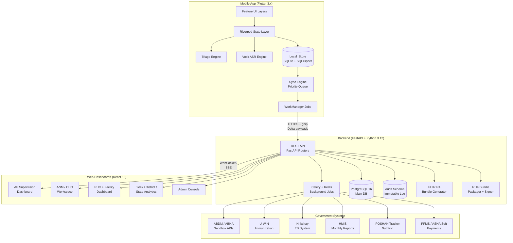
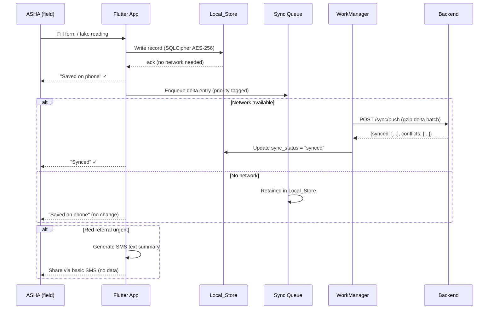
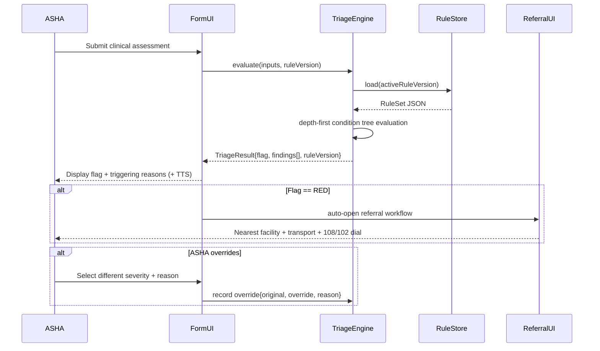
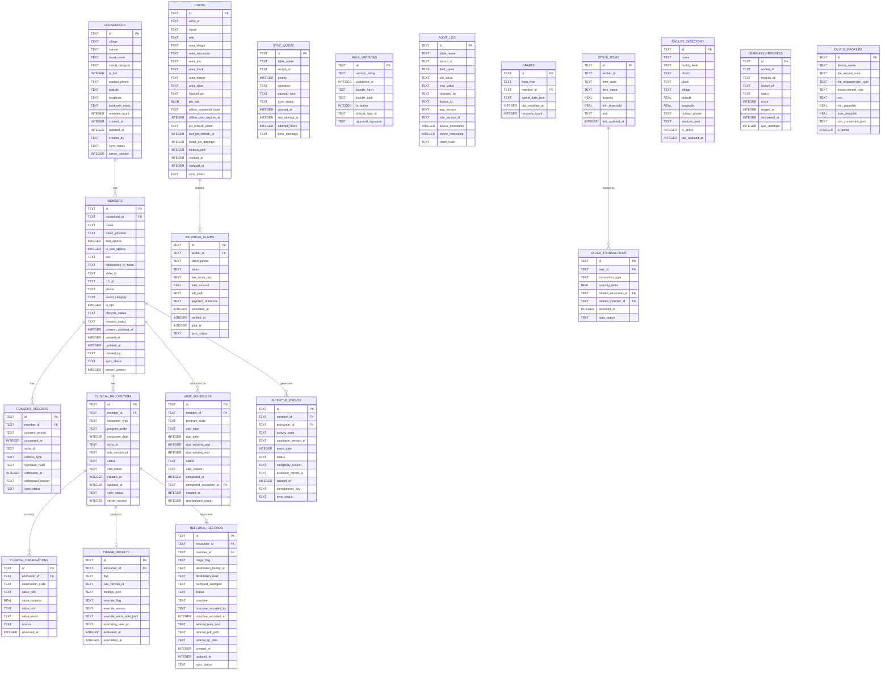
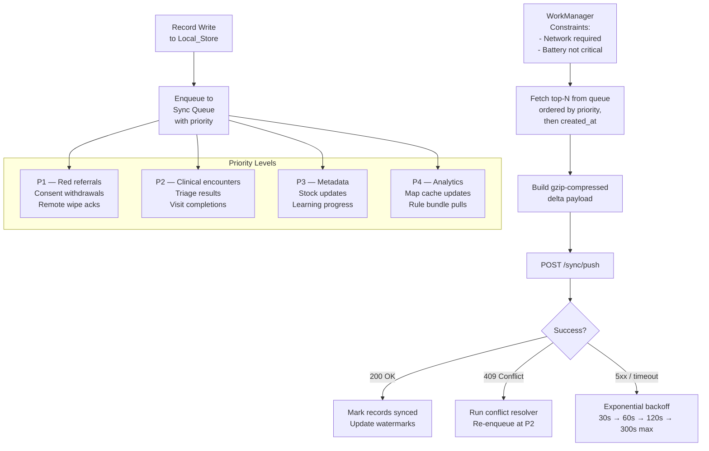
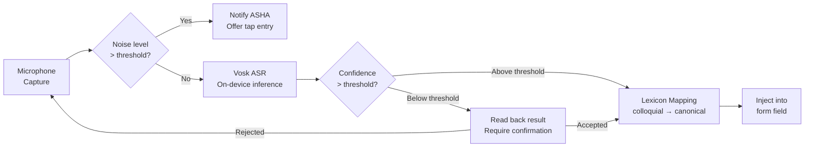
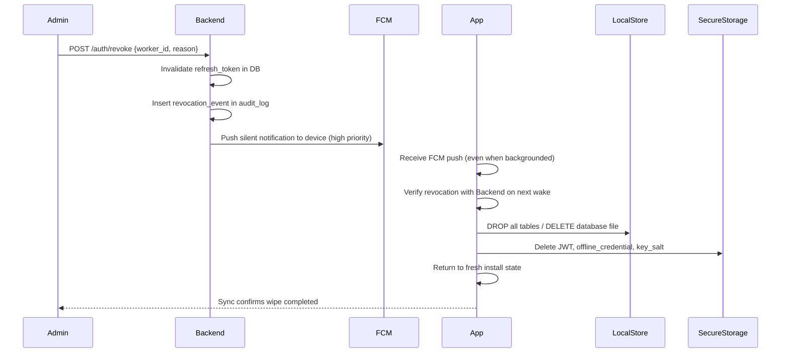
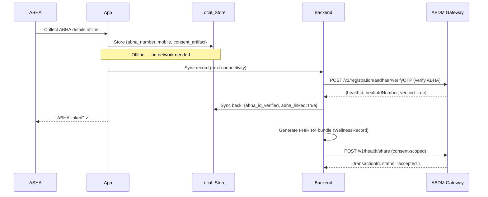

# Design Document: ASHA Digital Platform

## Overview

The ASHA Digital Platform is a three-tier offline-first health information system built for deployment across rural and peri-urban India. It comprises:

1. **Flutter mobile app** — the primary tool for ASHA workers, running on low-end Android devices (≥ Android 9, ≥ 2 GB RAM). The local SQLite database is the authoritative source of truth; no workflow requires an active network connection.
2. **FastAPI + PostgreSQL backend** — receives delta-sync payloads, resolves conflicts, orchestrates government system integrations, manages rule versioning, and serves analytics aggregations.
3. **React web dashboards** — role-scoped views for ASHA Facilitators, ANMs, PHC Medical Officers, Block/District/State officers, and administrators.

The design follows five non-negotiable architectural constraints drawn directly from the requirements:

| Constraint | Implication |
|---|---|
| Offline-first | Local_Store is primary; server is sync target, never a prerequisite |
| Low-end phones | APK base < 50 MB; no persistent background services; WorkManager for all background work |
| Voice + icon first | Vosk ASR on-device; flutter_tts; every screen has an audio prompt |
| Deterministic triage | Rule engine is pure function; same inputs always produce same output |
| Worker trust | ASHA sees the same performance data her supervisor sees; no covert tracking |

---

## Architecture

### High-Level System Diagram



### Offline-First Data Flow



### Component Interaction — Triage Path



---

## Components and Interfaces

### 2.1 Flutter Mobile App Architecture

#### Folder Structure (Feature Slices)

```
lib/
├── main.dart
├── app/
│   ├── app.dart                    # ProviderScope, MaterialApp, go_router
│   ├── router.dart                 # GoRouter with role-based guards
│   └── theme/
├── core/
│   ├── database/
│   │   ├── app_database.dart       # drift AppDatabase class
│   │   ├── daos/                   # One DAO per entity group
│   │   └── migrations/             # Versioned schema migrations
│   ├── sync/
│   │   ├── sync_engine.dart        # Priority queue + delta builder
│   │   ├── sync_worker.dart        # WorkManager Dart entry point
│   │   └── conflict_resolver.dart
│   ├── security/
│   │   ├── key_manager.dart        # PBKDF2 key derivation
│   │   ├── auth_service.dart       # JWT + offline credential
│   │   └── remote_wipe.dart
│   ├── triage/
│   │   ├── triage_engine.dart      # Pure function evaluator
│   │   ├── rule_loader.dart        # OTA bundle verify + load
│   │   └── models/
│   ├── voice/
│   │   ├── vosk_service.dart       # Vosk lifecycle manager
│   │   ├── lexicon_service.dart    # Colloquial → canonical mapping
│   │   └── tts_service.dart        # flutter_tts wrapper
│   ├── pdf/
│   │   └── pdf_generator.dart      # pdf Dart package abstractions
│   └── l10n/                       # ARB files for 12 languages
├── features/
│   ├── auth/
│   ├── household/
│   ├── triage/
│   ├── referral/
│   ├── clinical_programs/
│   │   ├── hbnc/
│   │   ├── hbyc/
│   │   ├── anc_pnc/
│   │   ├── immunization/
│   │   ├── nutrition/
│   │   ├── ncd/
│   │   └── tb/
│   ├── due_list/
│   ├── devices/                    # BLE + breath counter
│   ├── sync_status/
│   ├── learning/
│   ├── incentives/
│   └── settings/
└── shared/
    ├── widgets/
    └── providers/
```

Each feature slice follows the layered pattern:
```
features/household/
├── data/
│   ├── household_repository.dart   # Talks to DAOs + sync queue
│   └── household_dao.dart          # Generated drift DAO
├── domain/
│   ├── household_model.dart        # Dart domain model
│   └── duplicate_detector.dart
├── presentation/
│   ├── household_list_screen.dart
│   ├── household_detail_screen.dart
│   └── providers/
│       └── household_providers.dart  # @riverpod annotations
```

#### State Management: Riverpod 2.x

All async data access uses code-generated `@riverpod` annotations with `AsyncNotifier` for mutable state and `StreamProvider` for reactive database streams from drift:

```dart
// Example: reactive beneficiary list from Local_Store
@riverpod
Stream<List<MemberModel>> beneficiariesForHousehold(
  BeneficiariesForHouseholdRef ref,
  String householdId,
) {
  final dao = ref.watch(memberDaoProvider);
  return dao.watchMembersByHousehold(householdId);
}

// Example: triage computation (pure, no side effects)
@riverpod
TriageResult computeTriage(ComputeTriageRef ref, TriageInputs inputs) {
  final engine = ref.watch(triageEngineProvider);
  return engine.evaluate(inputs);
}
```

State follows a three-layer model:
1. **Repository layer** — abstracts DAOs + sync queue enqueue
2. **Provider layer** — Riverpod providers expose streams/futures to UI
3. **UI layer** — ConsumerWidgets subscribe to providers; no direct DAO calls

#### Navigation: go_router with Role Guards

```dart
// Role-based guard example
redirect: (context, state) {
  final role = ref.read(authProvider).role;
  if (state.matchedLocation.startsWith('/admin') && 
      role != UserRole.stateAdmin) {
    return '/home';
  }
  return null;
}
```

Route groups:
- `/` → splash + auth gate
- `/home` → ASHA home (due list)
- `/household/:id` → beneficiary registry
- `/visit/:id` → clinical encounter
- `/triage` → triage flow
- `/referral/:id` → referral workflow
- `/programs/*` → clinical program sub-routes
- `/learning` → training module
- `/incentives` → earnings dashboard
- `/af/*` → AF supervisory views (role-gated)
- `/settings` → language, PIN, privacy

#### Dependency Injection

Services are provided via Riverpod providers defined in `shared/providers/`:

```dart
@Riverpod(keepAlive: true)
AppDatabase appDatabase(AppDatabaseRef ref) => AppDatabase(openEncryptedDb());

@Riverpod(keepAlive: true)
TriageEngine triageEngine(TriageEngineRef ref) {
  final rules = ref.watch(activeRuleSetProvider).valueOrNull;
  return TriageEngine(ruleSet: rules ?? RuleSet.empty());
}
```

---

### 2.2 Local Database Schema (drift ORM)

#### Encryption Key Derivation

The SQLCipher encryption key is derived from the user's PIN using PBKDF2:

```dart
// Key derivation — 100,000 iterations, SHA-256, 32-byte output
Uint8List deriveKey(String pin, Uint8List salt) {
  final pbkdf2 = PBKDF2(hash: sha256);
  return pbkdf2.deriveKey(pin.codeUnits, salt, 100000, 32);
}
```

The salt is stored in Android Keystore-backed `EncryptedSharedPreferences`. The derived key is passed to `sqlcipher_flutter_libs` via `NativeDatabase.opened()` with `PRAGMA key`.

#### Entity-Relationship Diagram



#### Key Indexes

```sql
-- FTS5 virtual table for beneficiary search (name, phonetic variants, ABHA, phone)
CREATE VIRTUAL TABLE members_fts USING fts5(
    member_id UNINDEXED,
    name,
    name_phonetic,
    abha_id,
    rch_id,
    phone,
    village,
    content='members',
    content_rowid='rowid'
);

-- Sync queue query: highest priority first, pending only
CREATE INDEX idx_sync_queue_pending ON sync_queue(priority DESC, created_at ASC)
    WHERE sync_status = 'pending';

-- Due list query: tasks due today for this worker, ordered by priority
CREATE INDEX idx_visit_schedules_due ON visit_schedules(due_date, status);

-- Encounter lookup by member + program
CREATE INDEX idx_encounters_member_program ON clinical_encounters(member_id, program_code, encounter_date DESC);

-- Incentive deduplication by idempotency key
CREATE UNIQUE INDEX idx_incentive_events_idempotency ON incentive_events(idempotency_key);

-- Audit chain lookup
CREATE INDEX idx_audit_log_record ON audit_log(table_name, record_id, device_timestamp);
```

---

### 2.3 Sync Engine Design

#### BitChat-Style Priority Queue



#### Sync Push Payload Structure

```typescript
// POST /sync/push
interface SyncPushRequest {
  device_id: string;
  worker_id: string;
  app_version: string;
  batch_id: string;          // UUID for idempotent retry detection
  sent_at: number;           // Unix ms, device clock
  records: SyncRecord[];
}

interface SyncRecord {
  table: string;
  record_id: string;
  operation: "insert" | "update" | "delete";
  priority: 1 | 2 | 3 | 4;
  payload: Record<string, unknown>;  // Full row for insert, changed fields for update
  event_log: EventLogEntry[];        // Append-only provenance entries
  device_timestamp: number;
  client_watermark: number;          // Last server-ack'd seq for this table
}

interface EventLogEntry {
  field: string;
  old_value: unknown;
  new_value: unknown;
  changed_by: string;
  device_id: string;
  device_timestamp: number;
}

// Server response
interface SyncPushResponse {
  batch_id: string;
  server_received_at: number;
  synced: string[];           // record_ids successfully persisted
  conflicts: ConflictItem[];
  server_watermarks: Record<string, number>;  // table → latest server seq
}

interface ConflictItem {
  record_id: string;
  table: string;
  conflict_type: "field_conflict" | "duplicate_identity";
  both_values: { client: unknown; server: unknown; field: string }[];
  resolution: "auto_merged" | "flagged_for_review";
}
```

#### Conflict Resolution Algorithm

```
For each incoming record R from client:

1. Load server version S of same record_id (if exists)
2. For each field F in R:
   a. If S has no value for F → accept client value (insert)
   b. If R.event_log[F].device_timestamp > S.event_log[F].device_timestamp:
      → Accept client value (last-write-wins per field)
   c. If timestamps equal and values differ:
      → Retain BOTH in event_log; set field to most recent by server_received_at
      → Flag record in `conflict_review` table for ANM/AF review
3. Clinical measurement conflicts (same member, same day, different worker):
   → Store both with full provenance; display most recent in App
   → Make both visible in conflict detail view
4. Duplicate beneficiary detection (name + DOB + area match):
   → Queue in `pending_merge` table; do NOT auto-merge
   → Notify designated ANM/AF reviewer
```

#### Delta Watermark Strategy

Each device tracks `last_synced_seq` per table. The server maintains a monotonically increasing `server_seq` per record. The pull endpoint returns all records modified since the device's watermark:

```
GET /sync/pull?worker_id={id}&watermarks={"members":1234,"encounters":5678,...}
```

#### SMS Fallback for Red Referrals

When data connectivity is unavailable for a Red referral, the App generates a compact SMS text:

```
ASHA REFERRAL [date]
Pt: [member_id_short] [age]y [sex]
Flag: RED — [primary_finding]
Facility: [facility_name]
ASHA: [name] [phone]
Ref#: [referral_id_short]
```

This can be sent via Android's native SMS intent, requiring no data connection.

---

### 2.4 Triage Engine

#### Rule DSL: JSON Condition Tree

```json
{
  "rule_id": "INFANT_FAST_BREATHING",
  "version": "1.0.0",
  "source_citation": "IMNCI Chart Booklet 2014, MoHFW, p.12",
  "age_band": "INFANT_0_2M",
  "severity": "RED",
  "condition": {
    "op": "and",
    "children": [
      { "op": "gte", "field": "respiratory_rate", "value": 60 },
      { "op": "lte", "field": "age_days", "value": 60 }
    ]
  },
  "finding_template": "Breathing rate {respiratory_rate}/min in infant {age_days} days — refer now",
  "action": "REFER_IMMEDIATELY"
}
```

**Supported operators:** `gt`, `lt`, `gte`, `lte`, `eq`, `neq`, `in`, `not_in`, `and`, `or`, `not`, `present`, `absent`.

#### Evaluation Algorithm

```dart
class TriageEngine {
  final RuleSet ruleSet;

  // Pure function — no I/O, no side effects
  TriageResult evaluate(TriageInputs inputs) {
    final ageBand = AgeBandResolver.resolve(inputs.ageInDays);
    final applicableRules = ruleSet.rulesForAgeBand(ageBand);

    TriageFlag highestFlag = TriageFlag.green;
    final List<TriageFinding> findings = [];
    final List<String> missingFields = [];

    // Check required fields first
    for (final field in ageBand.requiredFields) {
      if (!inputs.hasField(field)) missingFields.add(field);
    }

    // Evaluate all rules (no short-circuit — collect all findings)
    for (final rule in applicableRules) {
      final result = _evaluateCondition(rule.condition, inputs);
      if (result == ConditionResult.matched) {
        findings.add(TriageFinding.fromRule(rule, inputs));
        if (rule.severity.index > highestFlag.index) {
          highestFlag = rule.severity;
        }
      }
    }

    // Escalate if missing required inputs
    if (missingFields.isNotEmpty && highestFlag != TriageFlag.red) {
      highestFlag = highestFlag.escalate();
    }

    return TriageResult(
      flag: highestFlag,
      findings: findings,
      missingFields: missingFields,
      ruleVersionId: ruleSet.versionId,
      evaluatedAt: DateTime.now(),
    );
  }

  ConditionResult _evaluateCondition(Condition c, TriageInputs inputs) {
    return switch (c.op) {
      'and' => c.children.every((ch) => _evaluateCondition(ch, inputs) == ConditionResult.matched)
          ? ConditionResult.matched : ConditionResult.unmatched,
      'or'  => c.children.any((ch) => _evaluateCondition(ch, inputs) == ConditionResult.matched)
          ? ConditionResult.matched : ConditionResult.unmatched,
      'not' => _evaluateCondition(c.children.first, inputs) == ConditionResult.matched
          ? ConditionResult.unmatched : ConditionResult.matched,
      'gte' => inputs.getNumeric(c.field) >= c.numericValue
          ? ConditionResult.matched : ConditionResult.unmatched,
      // ... other operators
      _ => ConditionResult.error,
    };
  }
}
```

**ML component integration:** When an ML severity score is present, the final flag is `max(rule_flag, ml_flag)`. The ML contribution is shown as a separately labelled item. ML can only raise severity, never lower it.

#### Rule Versioning and OTA Delivery

1. Backend packages new rule set as a signed JSON bundle with SHA-256 hash
2. App downloads bundle, verifies hash, stores in `rule_versions` table
3. New version activates only after full download and hash verification pass
4. Previous version retained for rollback; encounter records store `rule_version_id`
5. Automated test suite embedded in bundle must pass on Backend before release

#### Override Recording Schema

```dart
class TriageOverride {
  final String encounterId;
  final TriageFlag originalFlag;    // Engine output
  final TriageFlag overrideFlag;    // ASHA decision
  final String reason;              // 10–500 chars
  final String? voiceNotePath;
  final String overridingUserId;
  final DateTime overriddenAt;
}
```

---

### 2.5 Voice Input Pipeline (Vosk ASR)

#### On-Device Pipeline



#### Grammar Constraints for Closed Fields

For fields with a finite value set (yes/no, enumerated choices, numeric inputs), Vosk is initialised with a grammar constraint:

```dart
// Grammar for yes/no field in Hindi
final grammar = VoskGrammar(
  words: ['हाँ', 'ha', 'haan', 'नहीं', 'nahi', 'nahin', 'yes', 'no'],
);
recognizer.setGrammar(grammar);

// Grammar for respiratory rate (0-99 BPM)
final rrGrammar = VoskGrammar(
  words: ['[unk]', ...numberWordsHindi, ...numberWordsEnglish]
);
```

#### Lexicon JSON Structure

```json
{
  "language": "hi",
  "version": "2024.1",
  "entries": [
    {
      "spoken_variants": ["साँस तेज़", "सांस फूलना", "हाँफना", "तेज सांस"],
      "canonical_concept": "FAST_BREATHING",
      "field_type": "symptom_flag",
      "confidence_boost": 0.1
    },
    {
      "spoken_variants": ["पीलिया", "पीला", "आँखें पीली"],
      "canonical_concept": "JAUNDICE",
      "field_type": "symptom_flag",
      "confidence_boost": 0.0
    },
    {
      "spoken_variants": ["तीस", "30", "तीस साल"],
      "canonical_concept": "30",
      "field_type": "numeric",
      "output_transform": "numeric"
    }
  ]
}
```

#### Idempotence of Lexicon Normalisation

The `canonicalise(term)` function is a pure lookup: applying it twice to the same string produces the same canonical concept. Once a term is mapped to a canonical concept, re-running the mapping on the already-canonical concept returns the same concept unchanged (canonical concepts are their own identity under the mapping).

#### Model Management Strategy

- Base App includes no interpreter, ASR, or voice model. The worker explicitly installs the required interpreter language from Offline Packs; merely opening an interpreter screen never starts a large download.
- Each language model is an independently downloadable `.zip` bundle, verified by SHA-256 before extraction
- Models stored in app-private storage (`getApplicationSupportDirectory()`), excluded from cloud backup
- RAM check on startup: if device RAM < 1.5 GB, the large (40 MB) model is replaced with the small (~15 MB) compressed model; if RAM < 1 GB, voice input falls back to tap-only with a user notification

#### Optional Content Pack Delivery

- The base APK contains no geo map payload. A server build creates an allowlisted `map-india.zip` archive from reviewed geo source files, and the app installs it only after explicit worker action.
- Non-English UI language bundles are served as individually versioned `ui-<language>.zip` archives. English remains the base fallback; a non-English option is not shown in the picker until its verified pack is installed.
- The API publishes a pack manifest and immutable downloads carrying a SHA-256 header. The app verifies the archive, rejects paths and files outside the pack allowlist, extracts to app-private `content-packs/<pack-id>` storage, and installs atomically from a staging directory.
- Pack removal deletes only that pack's downloaded files. It must never remove clinical records, credentials, or queued sync packets.

---

### 2.6 FastAPI Backend Architecture

#### Router Structure

```
backend/
├── main.py                    # FastAPI app factory, lifespan, CORS
├── api/
│   ├── v1/
│   │   ├── auth.py            # /auth/login, /auth/refresh, /auth/revoke
│   │   ├── sync.py            # /sync/push, /sync/pull
│   │   ├── rules.py           # /rules/latest, /rules/{version}
│   │   ├── referrals.py       # /referrals, /referrals/{id}/outcome
│   │   ├── facilities.py      # /facilities (full directory download)
│   │   ├── incentives.py      # /incentives/claims, /incentives/events
│   │   ├── analytics.py       # /analytics/coverage, /analytics/district
│   │   ├── admin.py           # /admin/users, /admin/config, /admin/orgs
│   │   ├── fhir.py            # /fhir/bundle, /fhir/consent
│   │   └── audit.py           # /audit/trail/{record_id}
├── models/
│   ├── db/                    # SQLAlchemy ORM models (mirrors mobile schema + server fields)
│   └── schemas/               # Pydantic request/response schemas
├── services/
│   ├── sync_service.py        # Conflict resolution, idempotent upserts
│   ├── fhir_service.py        # FHIR R4 resource generation (fhir_r4)
│   ├── rule_service.py        # Bundle packaging, signing, test execution
│   ├── incentive_service.py   # Eligibility evaluation, claim generation
│   ├── analytics_service.py   # Coverage indicator computation
│   └── notification_service.py # FCM push + email alerts
├── workers/                   # Celery tasks
│   ├── abdm_sync.py           # ABDM/FHIR submission
│   ├── uwin_reconcile.py      # U-WIN import
│   ├── nikshay_sync.py        # Ni-kshay TB sync
│   ├── hmis_export.py         # Monthly HMIS indicator computation
│   └── ota_packager.py        # Rule/config bundle packaging
├── db/
│   ├── session.py             # Async SQLAlchemy session factory
│   └── migrations/            # Alembic migrations
└── core/
    ├── security.py            # JWT, bcrypt, rate limiting
    ├── config.py              # Pydantic Settings (env-based)
    └── multi_tenant.py        # State/district isolation middleware
```

#### PostgreSQL Schema (Server-Side Additional Fields)

Every synced table on the server adds:

```sql
-- Additional server-side columns on every synced table
ALTER TABLE members ADD COLUMN worker_id TEXT REFERENCES users(id);
ALTER TABLE members ADD COLUMN server_received_at TIMESTAMPTZ DEFAULT NOW();
ALTER TABLE members ADD COLUMN server_seq BIGINT GENERATED ALWAYS AS IDENTITY;
ALTER TABLE members ADD COLUMN state_code TEXT;
ALTER TABLE members ADD COLUMN district_code TEXT;
ALTER TABLE members ADD COLUMN block_code TEXT;

-- Conflict review table
CREATE TABLE conflict_review (
    id UUID PRIMARY KEY DEFAULT gen_random_uuid(),
    table_name TEXT NOT NULL,
    record_id TEXT NOT NULL,
    conflict_type TEXT NOT NULL,
    both_values JSONB NOT NULL,
    assigned_to TEXT REFERENCES users(id),
    status TEXT DEFAULT 'pending',
    resolved_at TIMESTAMPTZ,
    resolution_note TEXT,
    created_at TIMESTAMPTZ DEFAULT NOW()
);

-- Pending merge table for duplicate beneficiaries
CREATE TABLE pending_merge (
    id UUID PRIMARY KEY DEFAULT gen_random_uuid(),
    candidate_a_id TEXT NOT NULL,
    candidate_b_id TEXT NOT NULL,
    match_score FLOAT NOT NULL,
    match_fields JSONB,
    assigned_to TEXT REFERENCES users(id),
    status TEXT DEFAULT 'pending',
    resolved_at TIMESTAMPTZ
);
```

#### Multi-Tenant Isolation

Every API request carries the worker's JWT which includes `state_code`, `district_code`, `block_code`, `area_villages[]`. A SQLAlchemy middleware applies row-level filtering:

```python
# Applied to every query via event listener
@event.listens_for(Session, "do_orm_execute")
def add_area_filter(execute_state):
    if not execute_state.is_select:
        return
    ctx = current_tenant_context.get()
    if ctx.role in (Role.ASHA, Role.ASHA_FACILITATOR):
        execute_state.statement = execute_state.statement.filter(
            table.c.area_block == ctx.block_code
        )
```

#### FHIR R4 Resource Generation Pipeline

```python
from fhir.resources.R4B import bundle, patient, observation, immunization

def generate_anc_bundle(encounter: EncounterModel) -> bundle.Bundle:
    """Generate ABDM-compliant WellnessRecord FHIR bundle."""
    patient_resource = _build_patient(encounter.member)
    observations = [_build_observation(obs) for obs in encounter.observations]
    
    return bundle.Bundle(
        type="document",
        entry=[
            bundle.BundleEntry(resource=patient_resource),
            *[bundle.BundleEntry(resource=obs) for obs in observations],
        ],
        meta=Meta(profile=["https://nrces.in/ndhm/fhir/r4/StructureDefinition/WellnessRecord"])
    )
```

FHIR bundles are generated asynchronously by Celery workers and submitted to ABDM gateway endpoints only after the member's consent artifact is validated.

#### Background Jobs (Celery + Redis)

| Job | Trigger | Description |
|---|---|---|
| `abdm_sync` | On consent + record creation | Submit FHIR bundle to ABDM gateway |
| `uwin_reconcile` | Daily | Import vaccination status from U-WIN |
| `nikshay_sync` | Hourly | Bi-directional TB case sync |
| `hmis_export` | Monthly (1st of month) | Compute and prepare HMIS indicators |
| `ota_packager` | On rule/config approval | Package, sign, upload OTA bundle |
| `analytics_aggregator` | Every 15 min | Update coverage dashboards |
| `payment_exporter` | On claim approval | Push to PFMS / generate export |
| `outbreak_detector` | Every 30 min | Check case clustering thresholds |

---

### 2.7 React Web Dashboard Architecture

#### App Shell with Role-Based Layout

```
web-dashboard/
├── src/
│   ├── app/
│   │   ├── App.tsx
│   │   ├── router.tsx          # React Router v6, protected routes
│   │   └── queryClient.ts      # React Query client config
│   ├── layouts/
│   │   ├── AFLayout.tsx        # ASHA Facilitator shell
│   │   ├── ANMLayout.tsx       # ANM / CHO shell
│   │   ├── PHCLayout.tsx       # PHC / facility shell
│   │   ├── DistrictLayout.tsx  # District / block / state shell
│   │   └── AdminLayout.tsx     # Admin console shell
│   ├── features/
│   │   ├── af-supervision/     # AF dashboard pages
│   │   ├── anm-workspace/      # ANM workspace pages
│   │   ├── phc-dashboard/      # PHC referral queue + area lists
│   │   ├── analytics/          # District choropleth + indicators
│   │   ├── admin/              # User mgmt, config, OTA
│   │   └── incentives/         # Claim verification queue
│   ├── shared/
│   │   ├── components/
│   │   ├── hooks/
│   │   └── api/                # Typed API clients (React Query)
│   └── types/
```

#### Key Page Components per Role

| Role | Key Pages |
|---|---|
| AF | ASHA performance grid, mentoring flags, field supervision checklists, recognition badges |
| ANM/CHO | Beneficiary verification queue, VHSND session entry, government portal export assistant, claim verification |
| PHC MO | Live referral queue (sorted RED first), area health lists (high-risk pregnancy, SAM, TB), facility planning view |
| District Officer | Choropleth coverage maps, outbreak alerts, supply forecasts, data-quality heatmap |
| State Admin | User bulk onboarding, incentive catalogue editor, OTA deployment monitor, state setup checklist |

#### React Query Configuration

```typescript
// Typed query hook example — referral queue
export function useReferralQueue(facilityId: string) {
  return useQuery({
    queryKey: ['referrals', 'pending', facilityId],
    queryFn: () => api.getReferralQueue(facilityId),
    refetchInterval: 30_000,       // Poll every 30s for new Red referrals
    staleTime: 10_000,
  });
}

// Mutation for recording referral outcome
export function useRecordOutcome() {
  const queryClient = useQueryClient();
  return useMutation({
    mutationFn: (outcome: ReferralOutcome) => api.postOutcome(outcome),
    onSuccess: (_, vars) => {
      queryClient.invalidateQueries({ queryKey: ['referrals', 'pending'] });
    },
  });
}
```

#### Offline-Capable ANM Tablet

For ANMs using tablets in the field, the web dashboard uses a service worker (Workbox) to cache:
- API responses for the sub-centre's beneficiary list (stale-while-revalidate)
- Static assets (immutable cache)
- IndexedDB for form drafts and pending claim verifications

---

## Data Models

### 1. Member (Beneficiary)

```dart
// Dart (Mobile)
@DataClassName('MemberEntry')
class Members extends Table {
  TextColumn get id => text()();                       // UUID v4, device-generated
  TextColumn get householdId => text().references(Households, #id)();
  TextColumn get name => text()();
  TextColumn get namePhonetic => text().nullable()();  // Soundex/Devanagari phonetic
  IntColumn get dobApprox => integer().nullable()();   // Unix ms
  BoolColumn get isDobApprox => boolean().withDefault(const Constant(false))();
  TextColumn get sex => textEnum<Sex>()();
  TextColumn get relationshipToHead => text().nullable()();
  TextColumn get abhaId => text().nullable()();
  TextColumn get rchId => text().nullable()();
  TextColumn get phone => text().nullable()();
  TextColumn get socialCategory => text().nullable()();
  BoolColumn get isBpl => boolean().nullable()();
  TextColumn get lifecycleStatus => textEnum<LifecycleStatus>()(); // active, deceased, migrated
  TextColumn get consentStatus => textEnum<ConsentStatus>()();
  IntColumn get consentUpdatedAt => integer().nullable()();
  IntColumn get createdAt => integer()();
  IntColumn get updatedAt => integer()();
  TextColumn get createdBy => text()();
  TextColumn get syncStatus => textEnum<SyncStatus>()();
  IntColumn get serverVersion => integer().nullable()();

  @override
  Set<Column> get primaryKey => {id};
}
```

```python
# Python (Backend)
class Member(Base):
    __tablename__ = "members"
    id: Mapped[str] = mapped_column(Text, primary_key=True)
    household_id: Mapped[str] = mapped_column(ForeignKey("households.id"))
    name: Mapped[str]
    name_phonetic: Mapped[Optional[str]]
    dob_approx: Mapped[Optional[datetime]]
    is_dob_approx: Mapped[bool] = mapped_column(default=False)
    sex: Mapped[str]
    abha_id: Mapped[Optional[str]] = mapped_column(unique=True, nullable=True)
    rch_id: Mapped[Optional[str]]
    phone: Mapped[Optional[str]]
    social_category: Mapped[Optional[str]]
    is_bpl: Mapped[Optional[bool]]
    lifecycle_status: Mapped[str] = mapped_column(default="active")
    consent_status: Mapped[str] = mapped_column(default="pending")
    # Server-side fields
    worker_id: Mapped[str] = mapped_column(ForeignKey("users.id"))
    state_code: Mapped[str]
    district_code: Mapped[str]
    block_code: Mapped[str]
    server_received_at: Mapped[datetime] = mapped_column(server_default=func.now())
    server_seq: Mapped[int] = mapped_column(BigInteger, Identity())
```

### 2. HouseholdRecord

```typescript
// TypeScript (Dashboard)
interface HouseholdRecord {
  id: string;              // UUID v4
  village: string;
  hamlet?: string;
  headName: string;
  socialCategory: "SC" | "ST" | "OBC" | "General";
  isBpl: boolean;
  contactPhone?: string;
  latitude?: number;
  longitude?: number;
  landmarkNotes?: string;
  memberCount: number;
  members: Member[];
  createdAt: number;       // Unix ms
  updatedAt: number;
  createdBy: string;       // worker_id
  syncStatus: SyncStatus;
}
```

### 3. ClinicalEncounter

```dart
// Dart domain model
class ClinicalEncounter {
  final String id;
  final String memberId;
  final EncounterType type;          // HBNC, HBYC, ANC, SICK_CHILD, etc.
  final String programCode;
  final DateTime encounterDate;
  final String ashaId;
  final String ruleVersionId;
  final EncounterStatus status;      // draft, complete, synced
  final List<ClinicalObservation> observations;
  final TriageResult? triageResult;
  final String? visitNotes;
}

class ClinicalObservation {
  final String id;
  final String encounterId;
  final String observationCode;      // SNOMED/LOINC-inspired codes
  final dynamic value;               // typed: numeric, text, enum, boolean
  final String valueUnit;
  final ObservationSource source;    // MANUAL, BLE_DEVICE, VOICE_INPUT, CALCULATED
  final DateTime observedAt;
}
```

### 4. TriageResult + TriageOverride

```dart
class TriageResult {
  final String id;
  final String encounterId;
  final TriageFlag flag;             // RED, YELLOW, GREEN
  final String ruleVersionId;
  final List<TriageFinding> findings;
  final List<String> missingFields;
  final bool escalatedForMissingData;
  final MLTriageContribution? mlContribution;  // nullable — only when ML present
  final DateTime evaluatedAt;
}

class TriageFinding {
  final String ruleId;
  final TriageFlag severity;
  final String findingText;          // Rendered in selected language
  final Map<String, dynamic> triggeringValues;
  final String action;
}

class TriageOverride {
  final String encounterId;
  final TriageFlag originalFlag;
  final TriageFlag overrideFlag;
  final String reason;               // 10–500 chars
  final String? voiceNotePath;
  final String overridingUserId;
  final DateTime overriddenAt;
}

class MLTriageContribution {
  final TriageFlag mlFlag;
  final Map<String, double> featureWeights;  // feature → relative weight
  final double confidenceScore;
}
```

### 5. ReferralRecord

```dart
class ReferralRecord {
  final String id;
  final String encounterId;
  final String memberId;
  final TriageFlag triageFlag;
  final String destinationFacilityId;
  final FacilityLevel destinationLevel;
  final String? transportArranged;
  final ReferralStatus status;       // created, en_route, arrived, outcome_recorded
  final ReferralOutcome? outcome;
  final String referralNoteText;
  final String? referralPdfPath;
  final String? referralQrData;
  final DateTime createdAt;
}

class ReferralOutcome {
  final String recordedBy;
  final DateTime recordedAt;
  final OutcomeType type;            // arrived, treated, admitted, discharged, did_not_reach
  final String? notes;
}
```

### 6. IncentiveEvent + IncentiveClaim

```dart
class IncentiveEvent {
  final String id;
  final String memberId;
  final String? encounterId;
  final String activityCode;
  final String catalogueVersionId;
  final DateTime eventDate;
  final IncentiveEventStatus status; // eligible, ineligible, claimed, verified, paid
  final String? ineligibilityReason;
  final String evidenceRecordId;
  final DateTime createdAt;
  final String idempotencyKey;       // hash(activityCode + memberId + eventDate)
}

class IncentiveClaim {
  final String id;
  final String workerId;
  final String claimPeriod;          // "2024-03" format
  final ClaimStatus status;          // generated, submitted, verified, approved, paid, rejected
  final List<ClaimLineItem> lineItems;
  final double totalAmount;
  final String? pdfPath;
  final String? paymentReference;
  final DateTime? submittedAt;
  final DateTime? verifiedAt;
  final DateTime? paidAt;
}

class ClaimLineItem {
  final String incentiveEventId;
  final String activityCode;
  final String memberCodedId;        // De-identified: hash(memberId + claimPeriod)
  final DateTime serviceDate;
  final double amount;
  final String evidenceRecordId;
  final String? rejectionReason;
  final String? verifierNotes;
}
```

### 7. SyncQueueEntry

```dart
class SyncQueueEntry {
  final String id;
  final String tableName;
  final String recordId;
  final int priority;                // 1–4 (lower = higher priority)
  final SyncOperation operation;     // insert, update, delete
  final Map<String, dynamic> payloadJson;
  final List<EventLogEntry> eventLog;
  SyncQueueStatus syncStatus;        // pending, in_flight, synced, error
  final DateTime createdAt;
  DateTime? lastAttemptAt;
  int attemptCount;
  String? errorMessage;
}
```

### 8. RuleSet (Triage Rule Structure)

```typescript
interface RuleSet {
  id: string;
  versionString: string;            // semver: "2.1.0"
  publishedAt: number;
  clinicalLeadId: string;
  approvalSignature: string;
  bundleHash: string;               // SHA-256 of canonical JSON
  ageBands: AgeBand[];
  rules: TRiageRule[];
  testSuite: TestCase[];
}

interface TriageRule {
  ruleId: string;
  ageBand: AgeBandCode;             // INFANT_0_2M, CHILD_2M_5Y, ADOLESCENT, ADULT, PREGNANT
  severity: "RED" | "YELLOW" | "GREEN";
  sourceCitation: string;
  condition: ConditionNode;
  findingTemplate: string;          // supports {field} interpolation
  action: string;
}

type ConditionNode =
  | { op: "and" | "or"; children: ConditionNode[] }
  | { op: "not"; children: [ConditionNode] }
  | { op: "gt" | "lt" | "gte" | "lte" | "eq" | "neq"; field: string; value: number | string }
  | { op: "in" | "not_in"; field: string; values: (number | string)[] }
  | { op: "present" | "absent"; field: string };

interface TestCase {
  testId: string;
  inputs: Record<string, unknown>;
  expectedFlag: "RED" | "YELLOW" | "GREEN";
  description: string;
}
```

### 9. ConsentArtifact

```dart
class ConsentArtifact {
  final String id;
  final String memberId;
  final String consentVersion;       // version of consent text shown
  final DateTime consentedAt;
  final String ashaId;               // witness
  final WitnessType witnessType;     // TAP_ACK, THUMBPRINT_PHOTO, VOICE_HASH
  final String signatureHash;        // SHA-256 of (memberId + consentVersion + timestamp + ashaId)
  final String? voiceAckAudioHash;   // SHA-256 of audio file, if voice acknowledgment
  final bool isGuardianConsent;
  final String? guardianRelationship;
  final DateTime? withdrawnAt;
  final String? withdrawalReason;
  SyncStatus syncStatus;
}
```

### 10. AuditLogEntry

```dart
class AuditLogEntry {
  final String id;
  final String tableName;
  final String recordId;
  final String? fieldName;           // null for record-level events (create, delete)
  final String? oldValue;
  final String? newValue;
  final String changedBy;            // user_id
  final String deviceId;
  final String appVersion;
  final String? ruleVersionId;       // set for clinical records
  final int deviceTimestamp;         // Unix ms, device clock
  final int? serverTimestamp;        // Unix ms, server clock (set on sync)
  final String chainHash;            // SHA-256(previousHash + recordId + fieldName + newValue + deviceTimestamp)
}
```

The chain hash forms an append-only tamper-evident log per record: any modification to a historical entry breaks all subsequent hashes in the chain, making tampering detectable at the next integrity check.

---

## API Design

### Authentication

```
POST /api/v1/auth/login
Request:
{
  "asha_id": "MH-PUN-001234",
  "password": "...",          // PIN or OTP
  "device_id": "uuid",
  "device_model": "Samsung Galaxy A12"
}
Response 200:
{
  "access_token": "eyJ...",           // 15-min JWT
  "refresh_token": "eyJ...",          // 30-day JWT
  "offline_credential": "...",        // 7-day device-bound credential (bcrypt hash)
  "user": { "id": "...", "role": "ASHA", "name": "...", "area": {...} }
}

POST /api/v1/auth/refresh
Request: { "refresh_token": "eyJ..." }
Response 200: { "access_token": "eyJ...", "expires_in": 900 }

POST /api/v1/auth/revoke   (admin only — remote wipe trigger)
Request: { "worker_id": "...", "reason": "device_lost" }
Response 200: { "revoked": true }
```

JWT payload structure:
```json
{
  "sub": "worker_uuid",
  "role": "ASHA",
  "state_code": "MH",
  "district_code": "PUN",
  "block_code": "MUL",
  "area_villages": ["VG001", "VG002"],
  "iat": 1700000000,
  "exp": 1700000900
}
```

### Bulk Delta Sync

```
POST /api/v1/sync/push
Content-Encoding: gzip
Request: SyncPushRequest (see §2.3)
Response 200: SyncPushResponse (see §2.3)
Response 409: { "conflicts": [...] }   // Non-fatal; conflicts returned for resolution

GET /api/v1/sync/pull
Query params:
  worker_id=uuid
  watermarks={"members":1234,"clinical_encounters":5678}  (URL-encoded JSON)
Response 200:
{
  "records": SyncRecord[],
  "server_watermarks": { "members": 1350, "clinical_encounters": 5690 },
  "has_more": false
}
```

### Rule Bundle Download

```
GET /api/v1/rules/latest
Query: age_bands=INFANT_0_2M,CHILD_2M_5Y   (optional filter)
Response 200:
{
  "version": "2.1.0",
  "published_at": 1700000000,
  "bundle_hash": "sha256:abc123...",
  "download_url": "/api/v1/rules/2.1.0/bundle.json.gz",  // pre-signed URL
  "test_results": { "passed": 142, "failed": 0 }
}
```

### Referral Outcome

```
POST /api/v1/referrals/{referral_id}/outcome
Request:
{
  "outcome_type": "arrived",
  "recorded_by": "facility_staff_id",
  "notes": "Patient admitted, BP controlled",
  "recorded_at": 1700000000
}
Response 200:
{
  "referral_id": "...",
  "status": "outcome_recorded",
  "asha_notified": true
}
```

### Facility Directory

```
GET /api/v1/facilities
Query: district_code=PUN&block_code=MUL&updated_since=1700000000
Response 200:
{
  "facilities": [{
    "id": "...",
    "name": "PHC Mulshi",
    "level": "PHC",
    "latitude": 18.5432,
    "longitude": 73.8765,
    "contact_phone": "020-XXXXXXXX",
    "services": ["ANC", "immunization", "delivery", "NCD"],
    "distance_km": null   // computed on device from ASHA GPS
  }],
  "total": 47,
  "etag": "abc123"    // for conditional GET
}
```

### Incentive Claim Submission

```
POST /api/v1/incentives/claims/{worker_id}
Request:
{
  "claim_period": "2024-03",
  "line_items": [{
    "incentive_event_id": "...",
    "activity_code": "HBNC_COMPLETE",
    "member_coded_id": "sha256:...",
    "service_date": "2024-03-15",
    "amount": 250.00,
    "evidence_record_id": "..."
  }],
  "total_amount": 2750.00
}
Response 200:
{
  "claim_id": "...",
  "status": "submitted",
  "submitted_at": 1700000000,
  "assigned_verifier": "ANM-PUN-001"
}
```

### Analytics — Coverage Indicators

```
GET /api/v1/analytics/coverage
Query: state_code=MH&district_code=PUN&period=2024-Q1&indicators=anc,immunization,hbnc
Response 200:
{
  "period": "2024-Q1",
  "geography": { "state": "Maharashtra", "district": "Pune" },
  "indicators": {
    "anc_coverage": { "numerator": 892, "denominator": 1021, "pct": 87.4, "target": 90.0 },
    "full_immunization": { "numerator": 340, "denominator": 398, "pct": 85.4, "target": 90.0 },
    "hbnc_completion": { "numerator": 156, "denominator": 178, "pct": 87.6, "target": 85.0 }
  },
  "generated_at": 1700000000
}
```

### FHIR Bundle Submission (ABDM)

```
POST /api/v1/fhir/bundle
Request:
{
  "member_id": "...",
  "encounter_id": "...",
  "hi_type": "WellnessRecord",    // WellnessRecord | ImmunizationRecord | OPConsultation
  "consent_artifact_id": "..."
}
Response 202: { "job_id": "celery-task-uuid", "status": "queued" }
Response 200: { "fhir_bundle_id": "...", "abdm_submission_id": "...", "status": "accepted" }
```

---

## Security Architecture

### SQLCipher Key Derivation

```dart
class KeyManager {
  static const int _pbkdf2Iterations = 100000;
  static const int _keyLengthBytes = 32;  // 256-bit AES

  Future<Uint8List> deriveKey(String pin) async {
    // Salt stored in Android Keystore-backed EncryptedSharedPreferences
    final salt = await _getOrCreateSalt();
    
    return PBKDF2(
      hashAlgorithm: sha256,
    ).deriveKey(
      password: utf8.encode(pin),
      salt: salt,
      iterations: _pbkdf2Iterations,
      bits: _keyLengthBytes * 8,
    );
  }

  // On PIN change: re-derive key, PRAGMA rekey = newKey, wipe old derived key from memory
  Future<void> changePin(String oldPin, String newPin, NativeDatabase db) async {
    final newKey = await deriveKey(newPin);
    await db.customStatement("PRAGMA rekey = '${hex.encode(newKey)}';");
  }
}
```

### JWT Token Architecture

| Token | Lifetime | Storage | Notes |
|---|---|---|---|
| Access token | 15 minutes | In-memory only | Included in every API request; never written to disk |
| Refresh token | 30 days | `flutter_secure_storage` (Android Keystore) | Used only for `/auth/refresh` |
| Offline credential | 7 days from last refresh | `flutter_secure_storage` + `audit_log` | bcrypt hash of (worker_id + device_id + expiry); checked on offline login |

### Certificate Pinning

```dart
// Implemented via http_certificate_pinning package
final client = HttpClient()
  ..badCertificateCallback = (cert, host, port) => false;

// Pinned SHA-256 fingerprints for production API domains
const pinnedCerts = {
  'api.ashaportal.nhm.gov.in': 'sha256/AAAA...==',
  'abdm.gov.in': 'sha256/BBBB...==',
};
```

On certificate mismatch, the App refuses the connection and presents an offline-capable fallback message. Certificate updates are delivered via OTA bundle with a 30-day overlap window.

### Role-Based Access Control Matrix

| Entity | ASHA | AF | ANM/CHO | PHC MO | Block Officer | State Admin | Auditor |
|---|---|---|---|---|---|---|---|
| Own beneficiaries | R/W | R | R/W | R | R (agg) | — | R |
| Other ASHA beneficiaries | — | R (area) | R (sub-ctr) | R (area) | R (agg) | — | R |
| Triage results | R/W | R | R/W | R | R (agg) | — | R |
| Referral notes | R/W | R | R/W | R/W | R (agg) | — | R |
| Incentive events | R own | R area | R/verify | — | R (agg) | — | R |
| TB / HIV / MH fields | R/W own | masked | R/W | R | — | — | R + redacted |
| Family planning fields | R/W own | masked | R/W | R | — | — | R + redacted |
| Rule sets | R | R | R | R | R | R/W | R |
| User management | — | — | — | — | — | R/W | R |
| Audit trail | — | — | limited | limited | — | R | R |

### Remote Wipe Flow



If FCM is unavailable, the App detects refresh-token revocation on its next sync attempt and triggers the wipe then.

---

## Performance Design

### APK Size Budget

| Component | Size | Notes |
|---|---|---|
| Flutter engine (arm64-v8a) | ~10 MB | Split APK; armeabi-v7a separate |
| App Dart code + assets | ~5 MB | Includes WHO growth tables, CBAC scoring |
| Base English UI strings | <1 MB | Non-English strings are pack-gated and may be refreshed OTA |
| Icons, illustrations | ~3 MB | WebP format, 1× and 2× |
| Embedded offline maps | 0 MB | India map data is an on-demand verified content pack |
| flutter_tts + language packs | ~2 MB bundled | Additional language packs: 5–15 MB each, OTA |
| **Base APK total** | **~21 MB** | Estimate before architecture/native-plugin variation; release CI measures the actual split APK |
| Hindi Vosk model (optional) | ~40 MB | Downloaded post-install; not in base APK |
| Additional language Vosk models | ~15–40 MB each | Optional OTA download |

### SQLite Query Optimisation Targets

| Query | Target | Technique |
|---|---|---|
| Due list for today | < 50 ms | Composite index on `(status, due_date)`; limit 100 |
| FTS5 beneficiary search | < 200 ms | `MATCH` query on `members_fts`; partial token prefix |
| Beneficiary timeline | < 100 ms | Index on `(member_id, encounter_date DESC)` |
| Sync queue drain (top 50) | < 20 ms | Partial index on `sync_status = 'pending'` |
| Triage rule load | < 10 ms | Active rule set kept in memory after first load |
| Household list for hamlet | < 80 ms | Index on `(hamlet, head_name)` |

EXPLAIN QUERY PLAN is run in CI for all benchmark queries; a test fails if the plan shows a full table scan on any table with >100 expected rows.

### WorkManager Sync Job Constraints

```dart
final syncConstraints = Constraints(
  networkType: NetworkType.connected,         // Any network (not Wi-Fi only)
  requiresBatteryNotLow: true,               // Skip if battery < 15%
  requiresStorageNotLow: true,               // Skip if storage < 100 MB
  requiresDeviceIdle: false,                 // Run even while in use
);

// Priority-1 sync (Red referrals): one-shot, expedited
final urgentSyncRequest = OneTimeWorkRequestBuilder<SyncWorker>()
  .setExpedited(OutOfQuotaPolicy.RUN_AS_NON_EXPEDITED_WORK_REQUEST)
  .setConstraints(Constraints(networkType: NetworkType.connected))
  .build();

// Regular background sync: periodic, every 15 min minimum
final periodicSyncRequest = PeriodicWorkRequestBuilder<SyncWorker>(
  Duration(minutes: 15),
).setConstraints(syncConstraints).build();
```

### Lazy Loading Strategy

| Module | Loading Strategy |
|---|---|
| Vosk ASR engine | Initialised on first microphone tap; kept in memory while form is active, disposed on navigation away |
| Offline maps | Tile files loaded on demand; in-memory LRU cache of 50 tiles |
| Learning content video | Streamed from local file; not buffered into RAM |
| PDF generator | Instantiated only during PDF generation; disposed immediately after |
| Analytics charts | Deferred render on tab switch; skeleton placeholder shown during load |
| Government export formatters | Loaded only when the relevant export action is triggered |

---

## Government Integration Design

### ABDM / ABHA Integration Flow



**ABDM FHIR hiTypes used:**
- `WellnessRecord` — ANC visits, HBNC/HBYC, CBAC screenings
- `ImmunizationRecord` — vaccine administrations
- `OPConsultation` — triage encounters + referral notes
- `DiagnosticReport` — lab results, RDT results

### U-WIN Reconciliation

```python
# Daily Celery job
async def reconcile_uwin(block_code: str, period_date: date):
    # U-WIN provides CSV export; no public API as of 2024
    uwin_records = await fetch_uwin_export(block_code, period_date)
    
    for record in uwin_records:
        local_member = await find_member_by_rch_id(record.rch_id)
        if not local_member:
            # Create stub member record flagged "uwin_import"
            await create_member_from_uwin(record)
            continue
        
        # Reconcile vaccination status
        for dose in record.vaccinations:
            existing = await find_vaccination(local_member.id, dose.vaccine, dose.dose_num)
            if not existing:
                await create_vaccination(local_member.id, dose, source="uwin_import")
            elif existing.source == "asha_manual" and dose.administered_date != existing.date:
                await create_conflict_review(existing, dose, conflict_type="date_mismatch")
```

### Ni-kshay TB Sync

| Direction | Fields | Mechanism |
|---|---|---|
| Import from Ni-kshay | Case ID, diagnosis date, treatment regimen, treatment status, outcome | REST API (Ni-kshay sandbox); polling every 4 hours |
| Export to Ni-kshay | Presumptive TB flags, ASHA follow-up records | REST API (batch submission on ANM approval) |

Field mapping stored in state-specific `nikshay_mapping.json` config file; no hardcoded field names in code.

### HMIS Monthly Indicator Computation

```python
HMIS_INDICATORS = {
    "ANC_1_COVERAGE": """
        SELECT COUNT(DISTINCT member_id) FROM clinical_encounters
        WHERE program_code = 'ANC' AND visit_sequence = 1
        AND encounter_date BETWEEN :start AND :end
        AND block_code = :block_code
    """,
    "FULL_IMMUNIZATION": """
        SELECT COUNT(DISTINCT member_id) FROM immunization_completions
        WHERE completed_by_age_months <= 12
        AND completion_date BETWEEN :start AND :end
        AND block_code = :block_code
    """,
    # ... 45 more indicators
}

# Computed by Celery job on 1st of each month; presented to ANM for review
# ANM approves → exported as HMIS Excel format (state-specific template)
```

### Export Formats

| System | Format | Mechanism |
|---|---|---|
| HMIS | State-specific Excel (.xlsx) | ANM reviews in Dashboard → guided entry assistant |
| POSHAN Tracker | CSV with fixed column headers | Bulk upload by ANM/State DEO |
| ANMOL | RCH-II Excel format | Guided pre-fill assistant in ANM workspace |
| PFMS / ASHA Soft | State-specific CSV | Automated via API where available; export otherwise |

---

## Correctness Properties

*A property is a characteristic or behavior that should hold true across all valid executions of a system — essentially, a formal statement about what the system should do. Properties serve as the bridge between human-readable specifications and machine-verifiable correctness guarantees.*

### Property 1: Clinical Record Serialisation Round-Trip

*For any* valid clinical record (Member, ClinicalEncounter, ConsentArtifact, IncentiveClaim) stored in the Local_Store, deserialising the serialised form must produce a value equal to the original across all field types — date, enum, numeric, nullable text, and blob.

**Validates: Requirements 1.2, 5.2, 9.1, 52.6**

---

### Property 2: Draft Recovery Idempotence

*For any* in-progress form draft stored in the Local_Store, applying the draft recovery sequence (read draft → populate form) any number of times must produce the same form state and must never create more than one draft record per form session.

**Validates: Requirements 1.3**

---

### Property 3: Triage Engine Determinism

*For any* combination of clinical inputs (age in days, vitals, symptom flags) and a fixed rule-set version, evaluating the triage engine on those inputs any number of times must always return the same flag, the same set of triggering findings, and the same missing-field list.

**Validates: Requirements 8.8**

---

### Property 4: Triage Severity Monotonicity (ML Component)

*For any* rule-based triage output `rule_flag` and ML component output `ml_flag`, the final combined flag must satisfy `final_flag.severity >= rule_flag.severity`. The ML component may only raise severity, never lower it.

**Validates: Requirements 8.9**

---

### Property 5: Missing-Input Escalation Monotonicity

*For any* set of clinical inputs where some required fields are absent, replacing an absent field with a normal (in-range) value must never increase the triage severity. Replacing an absent field with an abnormal (out-of-range) value must never decrease the triage severity.

**Validates: Requirements 8.4**

---

### Property 6: Sync Idempotence

*For any* sync batch submitted to the Backend, submitting the identical batch a second time (retry scenario) must produce the same final database state as submitting it once — no duplicate records, no duplicate event-log entries, and the same field values for all affected rows.

**Validates: Requirements 31.2, 32.1**

---

### Property 7: Sync Priority Ordering

*For any* set of pending sync records in the sync queue, the Sync_Engine must never dispatch a lower-priority record before all higher-priority records ahead of it in the queue have been sent or acknowledged.

**Validates: Requirements 31.1**

---

### Property 8: WHO Z-Score Monotonicity

*For any* (height, age_days, sex) combination within plausible physiological bounds, increasing the weight measurement while keeping all other inputs constant must produce a weight-for-age Z-score that does not decrease.

**Validates: Requirements 17.1**

---

### Property 9: Duplicate Beneficiary Detection Invariant

*For any* two beneficiary records with identical name (normalised to the same Unicode NFC form), the same date of birth (or same approximate age), and the same household identifier, the duplicate-detection function must return a match score above the configured threshold, regardless of the order in which the field comparisons are performed.

**Validates: Requirements 4.3**

---

### Property 10: Incentive Event Deduplication

*For any* eligible incentive-triggering event, recording that event N times (network retry scenario) must produce exactly one `IncentiveEvent` record in the Local_Store and on the Backend, as determined by the idempotency key `hash(activityCode + memberId + eventDate)`.

**Validates: Requirements 54.1, 54.6**

---

### Property 11: Incentive Historical Rate Invariant

*For any* approved incentive claim submitted before a catalogue effective-date change, the rate computation must use the catalogue version that was active on the date the eligible event was completed, not the current active version.

**Validates: Requirements 53.2**

---

### Property 12: Claim Line-Item Round-Trip

*For any* approved claim record, generating the PDF and parsing the resulting document must recover all line items with their original activity codes, amounts (no floating-point precision loss beyond 2 decimal places), member coded IDs, and service dates.

**Validates: Requirements 56.1, 56.7**

---

### Property 13: Lexicon Normalisation Idempotence

*For any* string input to the Lexicon normalisation function, applying the function twice must produce the same output as applying it once: `normalise(normalise(term)) == normalise(term)`.

**Validates: Requirements 6.2, 6.6**

---

### Property 14: Audit Hash-Chain Tamper Detection

*For any* synced audit log chain, modifying any byte of any historical `AuditLogEntry` (field value, timestamp, or user ID) must cause the chain-hash verification to fail when the chain is recomputed from that entry onwards.

**Validates: Requirements 33.2**

---

### Property 15: Event-Log Replay Consistency

*For any* beneficiary or encounter record, replaying the ordered event log from the beginning must always reproduce the current field values of the record.

**Validates: Requirements 33.3**

---

### Property 16: Conflict Merge Confluence

*For any* two independent sets of offline edits A and B applied to the same base record, merging A into B must produce the same result as merging B into A for all non-conflicting fields (fields edited by at most one of A or B).

**Validates: Requirements 32.2**

---

### Property 17: FHIR Resource Serialisation Round-Trip

*For any* valid FHIR R4 resource generated by the Backend, serialising it to JSON and parsing it back using the `fhir_r4` Python library must produce a resource equal to the original, with no field values lost, truncated, or type-coerced.

**Validates: Requirements 36.2, 52.6**

---

### Property 18: Rule Set Serialisation Round-Trip

*For any* triage rule set, serialising it to JSON and deserialising it must preserve all rule definitions, condition trees, threshold values (with full numeric precision), source citations, and test cases.

**Validates: Requirements 9.1**

---

## Error Handling

### Mobile App Error Taxonomy

| Error Class | Strategy | User Feedback |
|---|---|---|
| Network unavailable | Continue offline; queue for sync | "Saved on phone" status indicator |
| Storage below threshold | Warn; offer cache clear (only synced non-critical data) | Alert banner with "Clear cache" action |
| SQLCipher write failure | Retry 3×; if persists, show support contact | "Could not save. Contact support." |
| Triage rule load failure | Fall back to previous cached rule version; log event | Silent fallback; rule version shown in triage result |
| Vosk model load failure | Fall back to tap-only entry; log to Local_Store | "Voice input unavailable. Use tap entry." |
| BLE device read error | Offer manual entry; log device fault | Inline "Enter manually" button |
| JWT expiry (offline) | Use offline credential if within 7-day window | Transparent; re-auth prompt if expired |
| Biometric auth failure (3×) | Fall back to PIN/pattern | PIN entry screen with lock countdown |
| Invalid triage input | Highlight field; block submission | Field-level validation message (audio + text) |
| Sync conflict | Show "needs attention" indicator on record | Status indicator; resolve on next sync |
| Crash / unhandled exception | Capture stack trace to Local_Store (no PHI); transmit on next sync | Restart prompt; offer resume draft |

### Backend Error Handling

```python
# Global FastAPI exception handler
@app.exception_handler(SyncConflictError)
async def sync_conflict_handler(request: Request, exc: SyncConflictError):
    return JSONResponse(
        status_code=409,
        content={"conflicts": exc.conflicts, "batch_id": exc.batch_id}
    )

@app.exception_handler(ExternalSystemError)
async def external_system_handler(request: Request, exc: ExternalSystemError):
    # Log to incident table; return accepted (don't fail the sync)
    await log_integration_failure(exc)
    return JSONResponse(
        status_code=202,
        content={"status": "queued", "integration": exc.system, "error": exc.rejection_reason}
    )
```

External system failures (ABDM rejection, U-WIN timeout) are never allowed to block the primary sync operation. They are queued for retry and surfaced to the appropriate user role (ANM/admin) via the Dashboard.

### Data Validation at Entry

All clinical inputs are validated at entry time against a schema that includes:
- Physiological plausibility ranges (e.g., respiratory rate 5–200/min for all age groups)
- Date range checks (no future dates for historical events; no dates before patient DOB)
- Required-field checks with graceful degradation (missing fields trigger escalated triage, not blocking)
- Cross-field consistency (e.g., EDD must be ≥ LMP + 37 weeks)

Repeated bypass of validation warnings is logged to the audit trail for data-quality monitoring (Requirement 33.5).

---

## Testing Strategy

### Dual Testing Approach

The platform uses both property-based tests (for universal correctness) and example-based unit/integration tests (for specific scenarios and infrastructure wiring). They are complementary.

### Property-Based Testing Configuration

**Library choices:**
- **Dart/Flutter:** `package:glados` (property-based testing for Dart) with a minimum 200 iterations per property test
- **Python/FastAPI:** `hypothesis` library with `@given` decorator and `settings(max_examples=200)`

Each property test is tagged with a comment linking it to the design property:

```dart
// Feature: asha-digital-platform, Property 3: Triage engine determinism
@test
void triageDeterminismProperty() {
  glados<TriageInputs>().test(
    'triage engine returns identical result for same inputs',
    (inputs) {
      final result1 = engine.evaluate(inputs, ruleVersion: 'v2.0.0');
      final result2 = engine.evaluate(inputs, ruleVersion: 'v2.0.0');
      expect(result1, equals(result2));
    },
  );
}
```

```python
# Feature: asha-digital-platform, Property 6: Sync idempotence
@given(sync_batch=sync_batch_strategy())
@settings(max_examples=200)
async def test_sync_idempotence(sync_batch: SyncPushRequest):
    await sync_service.apply_batch(sync_batch)
    state_after_first = await db.snapshot_affected_records(sync_batch)
    
    await sync_service.apply_batch(sync_batch)  # exact retry
    state_after_second = await db.snapshot_affected_records(sync_batch)
    
    assert state_after_first == state_after_second
```

### Unit Testing

Unit tests focus on specific scenarios not covered by property tests:
- Authentication flows (PIN lockout sequence, biometric fallback, remote wipe chain)
- Draft recovery on simulated crash (write partial form, kill isolate, relaunch)
- Referral SMS text generation with boundary cases (long names, special characters)
- BLE reading rejection for out-of-range values
- Offline credential expiry detection

Target: **≥ 80% line coverage** on `core/` and `features/` directories.

### Integration Testing

Integration tests verify infrastructure wiring with real (test) databases and mock external services:
- Full sync round-trip: create record on device → sync → verify on Backend → pull → verify on device
- Conflict resolution: two concurrent offline edits to same field → merge → verify provenance preserved
- FHIR bundle submission: generate bundle → submit to ABDM sandbox → verify acceptance
- Rule OTA delivery: publish new rule set on Backend → device downloads → triage uses new rules

### Clinical Safety Testing (Non-Automated)

Before each triage rule set release:
- Clinician-labelled test case suite executed (embedded in rule bundle)
- Sensitivity/specificity computed against IMNCI gold-standard clinician labels
- Results reviewed by designated clinical authority before release sign-off

### Performance Testing

- Triage evaluation: benchmark on minimum-spec device (2 GB RAM, Android 9); target < 1 second
- Screen render: 60 fps target; Flutter DevTools timeline analysis on critical paths
- SQLite queries: EXPLAIN QUERY PLAN assertions in CI; no full-table-scan regressions
- APK size: automated check in CI pipeline; build fails if base APK exceeds 50 MB

### Accessibility Testing

All interactive screens are verified against:
- WCAG AA colour contrast ratios (automated via `flutter_accessibility_service` lint rules)
- TalkBack screen reader compatibility (manual test protocol on reference device)
- 48 × 48 dp minimum touch target (automated lint check)

> Full WCAG compliance validation requires manual testing with assistive technologies and expert accessibility review beyond automated checks.
